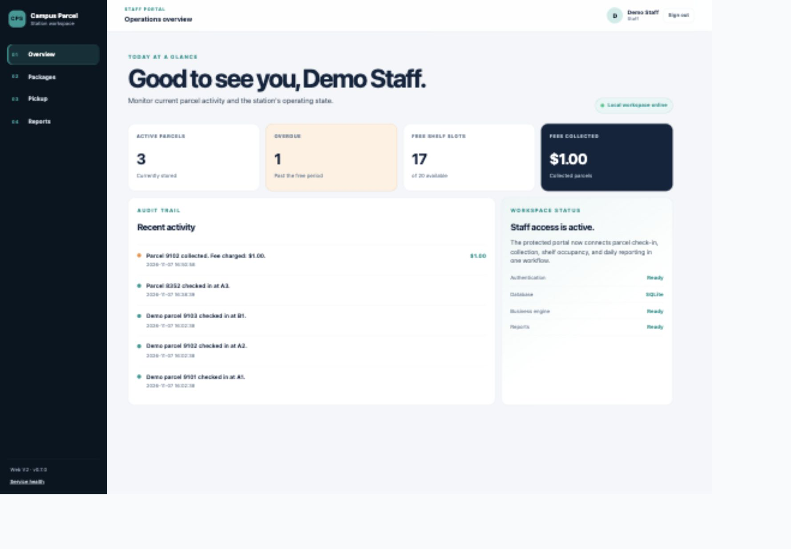
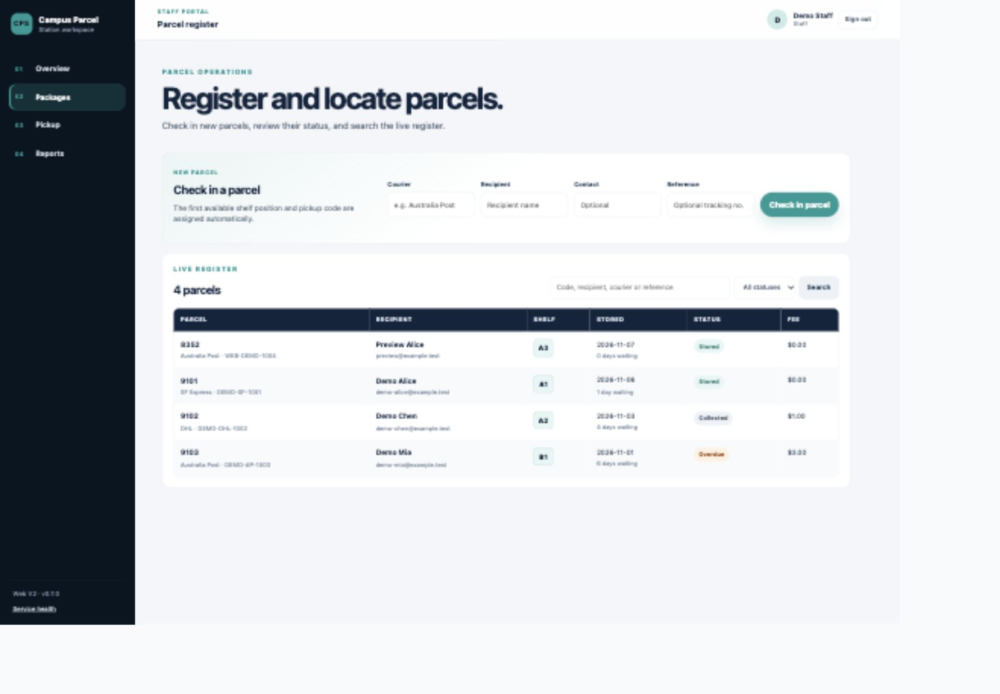
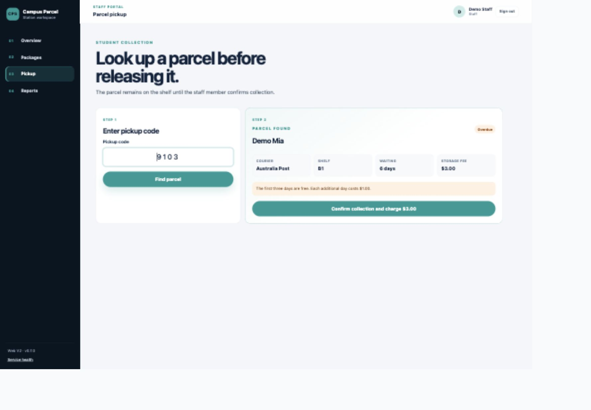
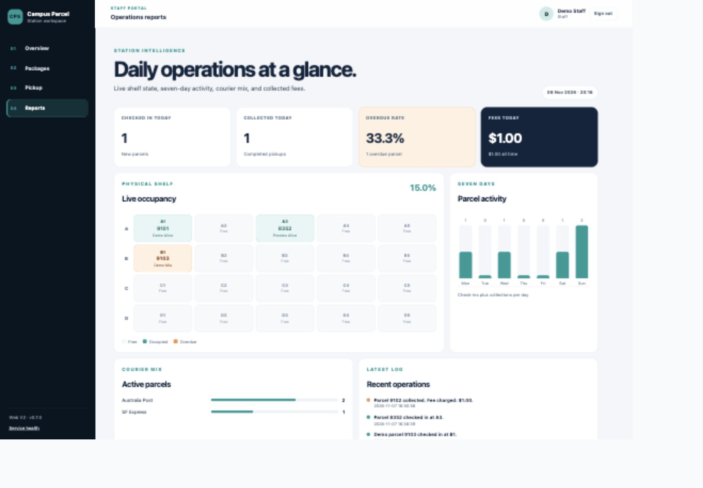

# Campus Parcel Station

A browser-based campus parcel station management system built with Python,
Flask, and SQLite. The application demonstrates a complete staff workflow:
secure sign-in, parcel check-in, live search, pickup confirmation, overdue-fee
calculation, shelf release, audit history, and operational reporting.

The project uses no paid APIs or external JavaScript frameworks. It is designed
to run locally without a custom domain or paid hosting.

## Application Preview

### Operations dashboard



### Parcel register



### Pickup and fee confirmation



### Shelf map and reports



## Features

### Staff access

- Password hashing with PBKDF2-SHA256
- Session-based authentication
- Protected staff pages
- CSRF-protected forms
- Sign-in and sign-out
- Styled error pages

### Parcel check-in

- Courier, recipient, contact, and tracking reference fields
- Server-side validation
- Automatic first-free-shelf allocation
- Unique four-digit pickup codes
- SQLite persistence
- Success and error feedback

### Parcel register

- Search by pickup code, recipient, courier, or tracking reference
- Filter by stored, overdue, or collected status
- Waiting-day calculation
- Automatic overdue status
- Current fee calculations

### Pickup workflow

- Lookup before collection
- Recipient and shelf verification
- Storage-fee preview
- Explicit staff confirmation
- Fee recording
- Automatic shelf release
- Audit log entry

### Reports

- Check-ins and pickups today
- Overdue rate
- Fees collected today and all time
- Live 4-by-5 shelf occupancy map
- Seven-day parcel activity
- Courier mix
- Recent operation history

## Technology Stack

| Layer | Technology |
|---|---|
| Backend | Python 3.9+, Flask 3.1 |
| Database | SQLite via Python `sqlite3` |
| Templates | Jinja2 |
| Frontend | HTML, responsive CSS, small vanilla JavaScript enhancement |
| Authentication | Flask sessions and Werkzeug password hashing |
| Testing | Python `unittest` |
| External services | None |

## Architecture

```text
Browser
  ↓
Flask routes and authentication
  ↓
Business services
  ├── parcels.py: check-in, lookup, pickup, search, fee rules
  └── reports.py: shelf map, daily metrics, courier mix
  ↓
SQLite persistence
  └── instance/parcel_station.sqlite
```

### Request flow for parcel check-in

```text
POST /packages/check-in
  → CSRF validation
  → login_required
  → parcels.check_in()
  → BEGIN IMMEDIATE transaction
  → find first free shelf
  → generate unique pickup code
  → insert package and operation log
  → commit
  → 303 redirect to parcel register
```

## Project Structure

```text
.
├── app.py
├── config.py
├── parcel_station/
│   ├── auth.py
│   ├── database.py
│   ├── errors.py
│   ├── schema.sql
│   ├── web.py
│   └── services/
│       ├── parcels.py
│       └── reports.py
├── templates/
├── static/
│   ├── css/app.css
│   └── js/app.js
├── tests/
├── screenshots/
├── legacy_cli/
├── docs/
├── requirements.txt
└── .gitignore
```

## Run Locally

### 1. Create a virtual environment

```bash
python3 -m venv .venv
source .venv/bin/activate
python3 -m pip install -r requirements.txt
```

### 2. Initialize the database

```bash
.venv/bin/flask --app app init-db
```

### 3. Add optional demonstration parcels

```bash
.venv/bin/flask --app app seed-demo
```

The demo command is safe to repeat. It will not insert duplicate records when
packages already exist.

### 4. Create a staff account

```bash
.venv/bin/flask --app app create-staff
```

The command prompts for username, display name, and a confirmed password.

### 5. Start the application

```bash
python3 app.py
```

Open:

```text
http://127.0.0.1:5001
```

Port `5001` is used because macOS AirPlay commonly occupies port `5000`.

## Tests

Run all automated tests:

```bash
.venv/bin/python -m unittest discover -s tests -v
```

The suite covers:

- Password login, logout, sessions, and CSRF
- Check-in, pickup, fee boundaries, and shelf release
- Search, filters, and database persistence
- Shelf-full, invalid-code, and empty-data cases
- Security headers and styled error pages
- Reports, shelf maps, and audit logs

Current result:

```text
Ran 32 tests
OK
```

## Business Rules

- Each stored parcel occupies exactly one shelf slot.
- Shelf slots are allocated from A1 through D5.
- Pickup codes contain four digits and are unique across all stored history.
- The first three waiting days are free.
- Each additional waiting day costs `$1.00`.
- Collected parcels release their shelf slot.
- Daily calculations use the `Australia/Sydney` timezone.
- Check-in and pickup changes are atomic database transactions.

## Data Storage

The local database is stored at:

```text
instance/parcel_station.sqlite
```

It is intentionally excluded from Git because runtime data may contain private
recipient information.

## Security Notes

- Passwords are never stored as plain text.
- Login and sign-out forms require CSRF tokens.
- Protected pages redirect unauthenticated visitors to sign-in.
- Responses include CSP, frame, MIME-sniffing, and referrer protections.
- Authenticated pages use `Cache-Control: no-store`.
- Forms disable their submit button while a request is pending.

This is a portfolio-grade local MVP, not yet a production campus service.
Before real institutional use, add HTTPS, login rate limiting, backup automation,
account recovery, audit retention policies, and a production WSGI server.

## Demo Account

A local-only demonstration account can be created from the CLI:

```bash
.venv/bin/flask --app app create-staff
```

Do not commit credentials to this repository. The local SQLite database is
excluded by `.gitignore`.

## GitHub Setup

This workspace is already a Git repository. Review files before committing:

```bash
git status
git add .
git commit -m "Build Campus Parcel Station web MVP"
```

Create and connect a GitHub repository manually, then push:

```bash
git remote add origin <your-repository-url>
git push -u origin main
```

Do not commit:

- `instance/parcel_station.sqlite`
- `.env`
- `.venv/`
- `__pycache__/`
- screenshots containing real recipient data

## Further Documentation

- [Architecture and data model](docs/ARCHITECTURE.md)
- [Three-minute demo script](docs/DEMO_SCRIPT.md)
- [Interview study guide](docs/INTERVIEW_GUIDE.md)
- [Resume project summary](docs/RESUME_SUMMARY.md)
